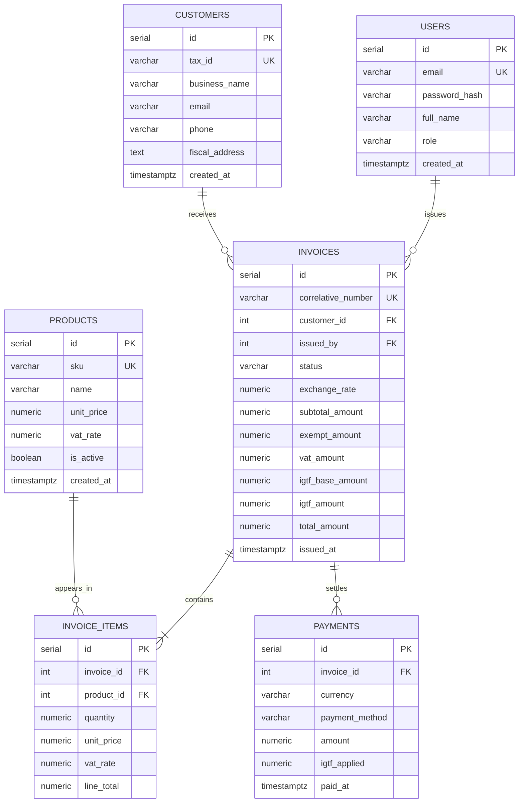

| Campo | Valor |
| --- | --- |
| Alumno | Miguel Adzael Flores Mora |
| Proyecto n.º | 37 — Facturación para pymes |
| Sitio de referencia | Zoho Invoice (https://www.zoho.com/invoice/) |
| Compañero revisor | Pendiente por asignar |
| URL desplegada | (se completa en el Sprint 5) |

## 1. Problema

Las pequeñas y medianas empresas (pymes) en Venezuela suelen emitir facturas y notas de cobro usando hojas de cálculo manuales o talonarios físicos, lo que provoca errores frecuentes en el cálculo combinado del IVA (16%) y del IGTF (3% sobre pagos en divisas), pérdida de la secuencia correlativa exigida y retrasos al entregar comprobantes al cliente. **Octo2^3** centraliza la facturación, garantiza la numeración correlativa sin saltos mediante control directo en archivo y genera comprobantes PDF listos para imprimir en segundos.

## 2. Usuarios

- **Usuario principal:** Administrador o facturador de una pyme comercial o de servicios que necesita registrar clientes, emitir facturas con desglose exacto de IVA e IGTF, registrar cobros mixtos (Bs/USD) e imprimir el PDF desde una laptop de mostrador o teléfono móvil.
- **Usuario secundario:** Contador o gerente (rol de auditoría/lectura) que entra desde computadora para verificar la secuencia correlativa de facturas, analizar gráficos mensuales de facturación e impuestos y exportar el libro de ventas en CSV.

## 3. Objetivo y métrica de éxito

«Un facturador de una pyme emite una factura con número correlativo único garantizado, cálculo exacto de IVA e IGTF según el método de pago y comprobante PDF listo para imprimir en menos de 45 segundos».

## 4. Alcance del MVP

Entre 5 y 8 funcionalidades que SÍ entran este semestre.

1. Autenticación de usuarios e inicio de sesión con control de acceso por roles (`admin`, `biller`, `auditor`).
2. Gestión de clientes fiscales (registro con RIF/cédula, validaciones, búsqueda rápida e importación/exportación en CSV).
3. Catálogo de productos y servicios (código SKU, precio unitario, tipo de alícuota de IVA y escaneo de código QR/barras con la cámara del dispositivo).
4. Emisión y anulación de facturas con numeración correlativa persistida en archivo, cálculo automático de subtotal, exentos, IVA (16% / 8% / 0%) y generación de comprobante PDF imprimible.
5. Registro de pagos multimoneda (bolívares y divisas/efectivo) con cálculo automático del 3% de IGTF sobre montos percibidos en moneda extranjera.
6. Panel de reportes fiscales con visualización gráfica en Canvas/SVG de ingresos e impuestos recaudados y exportación de resumen de ventas en CSV.

### Funcionalidades → carpetas de `src/` (screaming architecture)

Cada funcionalidad del alcance será una carpeta en `src/`. Nómbralas en inglés y en plural.

| Funcionalidad | Carpeta |
| --- | --- |
| Usuarios, sesiones y control de roles | `src/users` |
| Gestión de clientes e importación CSV | `src/customers` |
| Catálogo de productos/servicios y escáner por cámara | `src/products` |
| Emisión de facturas, correlativo en archivo e impresión PDF | `src/invoices` |
| Registro de cobros multimoneda y cálculo de IGTF | `src/payments` |
| Reportes fiscales, gráficos Canvas/SVG y exportación CSV | `src/reports` |

## 5. Fuera de alcance

Lo que NO vas a construir.

- Conexión por puerto serial con impresoras o máquinas fiscales físicas homologadas por el SENIAT.
- Contabilidad general completa (libro diario, libro mayor, conciliación bancaria o nómina).
- Pasarelas de cobro electrónico directo con tarjetas bancarias o validación automática de Pago Móvil.
- Facturación recurrente automatizada por suscripciones o arquitectura multiempresa (multi-tenant).

## 6. Requisitos funcionales

| ID | Requisito | Prioridad (alta, media, baja) |
| --- | --- | --- |
| RF-01 | El sistema debe permitir el inicio de sesión y restringir acciones según el rol (`admin`, `biller`, `auditor`). | Alta |
| RF-02 | El usuario debe poder crear, editar, listar y buscar clientes validando formato de RIF/cédula (`V-`, `J-`, `E-`, `G-`). | Alta |
| RF-03 | El usuario debe poder gestionar productos/servicios indicando código SKU, precio base y alícuota de IVA (general 16%, reducida 8% o exento 0%). | Alta |
| RF-04 | El facturador debe poder agregar ítems a una factura usando la cámara del dispositivo para leer códigos de barras o QR de productos. | Media |
| RF-05 | Al emitir una factura, el sistema debe asignar un número correlativo único e inmutable leído y actualizado atómicamente en un archivo dedicado en disco. | Alta |
| RF-06 | El sistema debe calcular automáticamente base imponible, monto exento, IVA y el 3% de IGTF cuando el pago o abono se registre en divisas. | Alta |
| RF-07 | El sistema debe permitir visualizar, descargar e imprimir cada factura emitida en formato PDF con todos los datos fiscales de emisor, receptor, correlativo y desglose tributario. | Alta |
| RF-08 | El sistema debe permitir anular una factura emitida conservando su número correlativo en el historial (sin eliminar el registro ni reutilizar el número). | Alta |
| RF-09 | El usuario debe poder importar catálogos (clientes/productos) desde archivo CSV y exportar el libro/reporte de facturas emitidas en CSV. | Media |
| RF-10 | El panel de reportes debe dibujar en Canvas o SVG un gráfico comparativo de facturación mensual, IVA e IGTF recaudados, permitiendo ordenar y filtrar facturas por fecha, monto o cliente. | Media |

## 7. Requisitos no funcionales

- Responsive, móvil primero (375 px y 1280 px).
- Lighthouse ≥ 90 en Accesibilidad y Buenas prácticas.
- 0 errores en la consola del navegador.
- Funciona con 10.000 registros sin congelarse.
- Integridad estricta en cálculos monetarios usando aritmética en centavos / `NUMERIC(12,2)` (sin errores de redondeo en punto flotante) y persistencia segura del archivo correlativo ante señales `SIGINT` y `SIGTERM`.

## 8. Modelo de datos

Diagrama entidad-relación y tablas PostgreSQL con tipos, claves y restricciones.

**Restricciones clave en PostgreSQL:**
- `customers.tax_id`, `products.sku`, `users.email` e `invoices.correlative_number` llevan restricción `UNIQUE NOT NULL`.
- Todos los importes monetarios utilizan `NUMERIC(12, 2)` con `CHECK (amount >= 0)` y `CHECK (quantity > 0)`.
- `invoices.status` restringido con `CHECK (status IN ('draft', 'issued', 'paid', 'voided'))` y `users.role` con `CHECK (role IN ('admin', 'biller', 'auditor'))`.

## 9. Reto técnico distintivo

**Reto asignado:** *Numeración correlativa en archivo + IVA e IGTF + impresión PDF.*

1. **Numeración correlativa en archivo:** Se implementará un gestor de secuencia usando descriptores de archivo de bajo nivel en Node.js (`fs.open` / `FileHandle` con lectura, actualización en el offset inicial y `datasync` a disco) sobre un archivo persistente (`data/invoice-sequence.dat`), coordinado mediante una cola en memoria para serializar peticiones concurrentes y dentro de la transacción SQL de creación de la factura. Así se garantiza un formato correlativo estricto (`FAC-00000001`, `FAC-00000002`...) sin duplicados, cerrando limpiamente los descriptores al recibir `SIGINT` o `SIGTERM`.
2. **Cálculo exacto de IVA e IGTF:** Toda operación aritmética se procesará trabajando en centavos enteros en TypeScript y `NUMERIC(12,2)` en PostgreSQL. Cada línea calculará su base según su alícuota (`16%`, `8%` o `0%` exento); posteriormente, al registrar pagos en moneda extranjera (`USD` efectivo/transferencia externa), se calculará el `3%` de IGTF exclusivamente sobre la porción pagada en divisas (respetando pagos mixtos Bs + USD).
3. **Impresión y exportación PDF:** Se diseñará una vista dedicada de factura fiscal con hoja de estilos de impresión (`@media print` formato Carta/A4 sin elementos de navegación) junto con generación de documento PDF descargable que incluya encabezado de la pyme, RIF del cliente, número correlativo, tabla de ítems, tasa BCV referencial y cuadro resumen de Base Imponible, Exento, IVA, Base IGTF, IGTF (3%) y Total General.

## 10. Riesgos y preguntas abiertas

- **Riesgo de concurrencia y atomicidad (Archivo vs. PostgreSQL):** Si la transacción en PostgreSQL falla después de incrementar el archivo correlativo, podría quedar un salto en la secuencia. *Mitigación:* validar todos los datos y bloquear la creación dentro de una cola secuencial antes de confirmar el commit y sincronizar el descriptor.
- **Riesgo de redondeo multimoneda:** Diferencias de céntimos al convertir entre bolívares y dólares. *Mitigación:* redondeo bancario/fiscal explícito a 2 decimales por etapa y pruebas unitarias con casos borde de pagos mixtos.
- **Pregunta abierta para el profesor:** ¿La tasa de cambio Bs/USD para mostrar equivalencias junto al IGTF debe ingresarse manualmente por el administrador cada día o consultarse desde una API externa con respaldo manual?